# VroomVroom Android — utilisation, tests et permissions

> 2026-11-02 · App Android (Capacitor v8, package `fr.ouiouibaguette.vroomvroom`)
> testée de bout en bout sur émulateur Pixel 7 (Android 14). Toutes les captures
> ci-dessous sont des tests réels effectués sur l'APK.

## 1. Deux modes de données

L'app démarre **toujours en mode local** (données sur le téléphone, IndexedDB,
aucun compte, aucun serveur). Le **mode serveur** (ton API FastAPI) est un mode
avancé caché : dans *Paramètres*, **10 taps rapides sur la ligne « Version »**
déverrouillent la section « Serveur (avancé) » (URL + clé API + test de connexion).

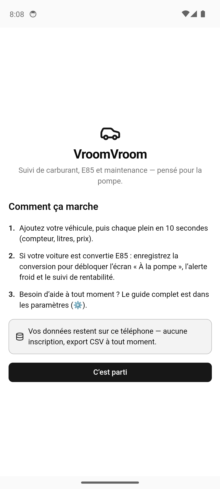
*Premier lancement : bienvenue + 3 étapes + rappel « données sur ce téléphone ». Aucun choix de mode.*

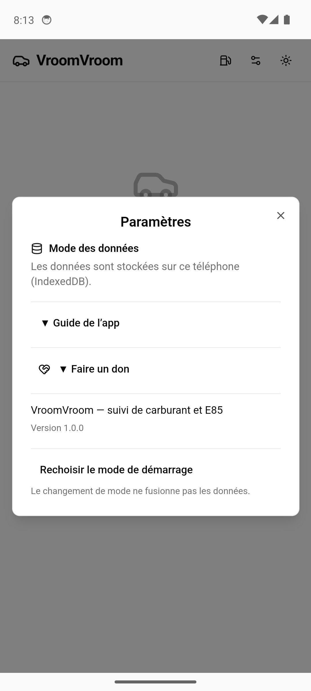
*Paramètres : mode des données, Guide de l'app (pliable), Faire un don, À propos, reset.*

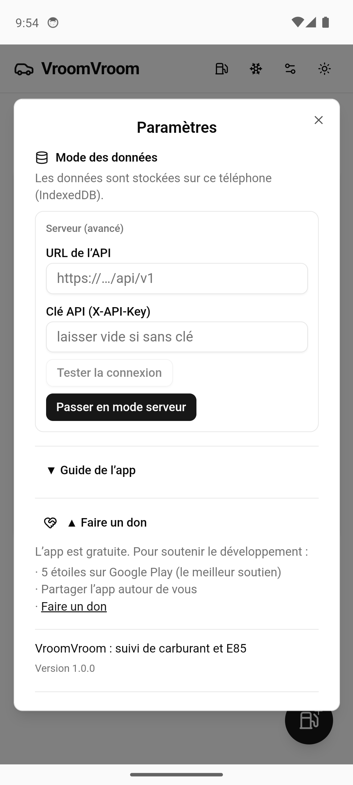
*« Faire un don » : 5 étoiles sur Google Play, partage, et lien `paypal.me/wiwibaguette`.*

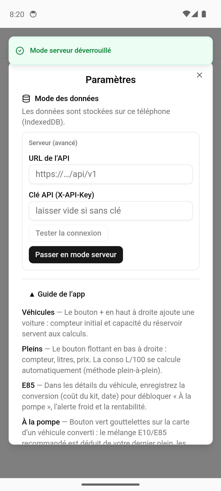
*Mode serveur déverrouillé (10 taps sur la version) : URL + clé + test de connexion.*
Pour que le mode serveur fonctionne sur ton API : ajouter `https://localhost` à
`BACKEND_CORS_ORIGINS` du `.env.docker` déployé (origine de la WebView Android),
optionnellement définir un `API_KEY`, puis relancer l'API.

## 2. Suivi de base (vérifié)

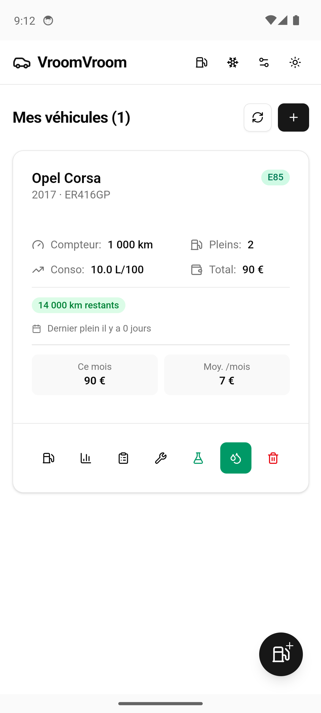
*Véhicule créé, 3 pleins, stats live (compteur / conso / total), badge assurance,
coût du mois. Tout est persisté dans IndexedDB et survit aux redémarrages.*

## 3. Module E85

### 3.1 Écran « À la pompe » (bouton goutte vert)


*État du réservoir déduit du dernier plein (50 L − 300 km × 10 L/100 = 20 L restants),
recommandation « 30,0 L E85 : plein direct » (grade d'hiver 75 % ≤ cible 77 % + tolérance),
prix pré-rempli (dernier prix E85), compteur pré-rempli.*

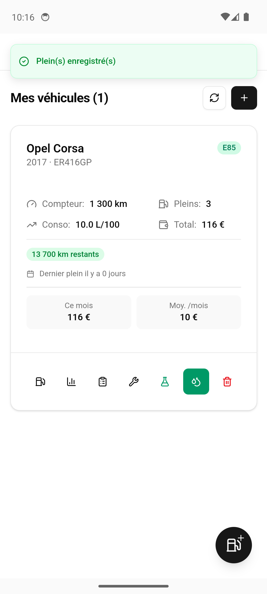
*Après « Enregistrer ces pleins » : toast, carte à jour (Pleins 3, Total 116 €,
assurance recalculée à 13 700 km). Le mélange E10+E85 est enregistré en 2 entrées
(booster partiel + plein) d'un seul coup.*

### 3.2 Calculateur de mélange (bouton fiole vert)

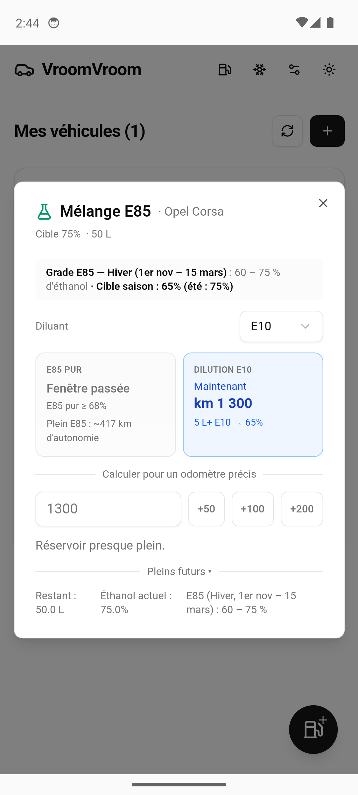
*Sur données réelles (Corsa, réservoir plein 50 L à 75 % d'éthanol, conso 10 L/100,
surconsommation boîtier 20 %) :*
- **« Plein E85 : ~417 km d'autonomie »** — nombre de km faisables avec un plein full-éthanol
  (50 L ÷ 12 L/100 = conso E10 × 1,20).
- **« Grade E85 — {saison} ({période}) : min – max % d'éthanol »** — la saison
  courante avec sa **fourchette** (les stations ne sont pas obligatoirement au taux
  nominal). Les 4 saisons : **Été** 1/5–30/9 : 85–85 % · **Intersaisons** 1/10–31/10
  et 16/3–30/4 : 65–75 % · **Hiver** 1/11–15/3 : 60–75 %.
- Cartes : « E85 PUR » (Jusqu'au km X / Fenêtre passée / Toujours possible) et
  « DILUTION E10 » (Maintenant / À partir du km Y / Inutile) — avec la cible
  saison, les seuils sont actifs **toute l'année** (capture ci-contre : hiver,
  réservoir à 75 % ≥ limite 68 % → « Fenêtre passée » + dilution « Maintenant »).
- Sélecteur de diluant (E10/SP98), calcul pour un odomètre précis (+50/+100/+200),
  simulation « Pleins futurs » par paliers.
- Tous les calculs de sécurité utilisent le **max** de la saison (surestimer
  l'éthanol = recommander plus d'essence, jamais moins).
- **Cible adaptée à la saison** : le taux cible est saisi sur l'échelle de l'été
  (85 % = max d'été) ; l'app le décale de (max_saison − 85). Ex. 75 % saisi →
  « Cible saison : 65 % (été : 75 %) » en hiver ; les calculs utilisent la cible
  saison (tolérance absolue). Le réglage enregistré ne change jamais. Modèle
  documenté dans `docs/plan-grade-e85-saisonnier.md`.

Ces seuils utilisent exactement les mêmes fonctions que la version serveur
(`computeThresholds` / `computeWinterRec` de `lib/blend-math.ts`) : le calculateur
est le même composant React dans les deux versions, seul le transport des données
diffère (API locale vs serveur), vérifié par diff différentiel (0 écart sur 19 endpoints).

### 3.3 Prix E10 de référence (seed automatique)

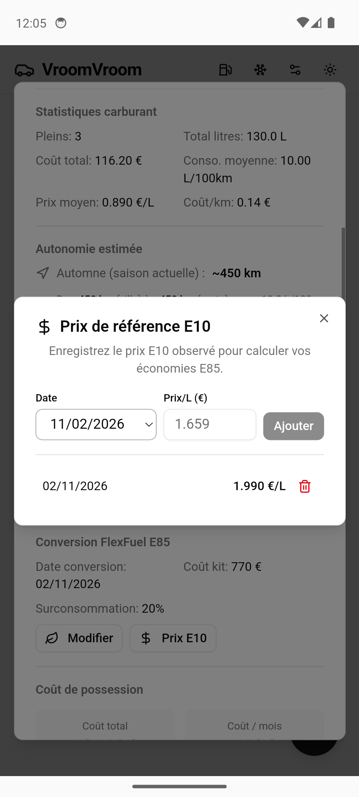
*À la première ouverture (mode local, aucune référence E10), l'app enregistre
automatiquement le prix le plus bas d'une station de Paris (données officielles
data.economie.gouv.fr) — ici 1,990 €/L du jour. La rentabilité E85 a donc une
référence dès le premier plein. Les prix observés ensuite s'ajoutent manuellement
(ou sont capturés automatiquement quand tu enregistres un plein E10).*

### 3.4 Détails du véhicule — autonomie

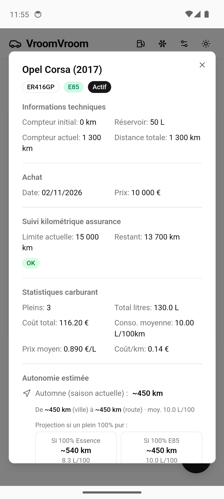
*Autonomie estimée par saison (villes/route), projection « Si 100 % Essence /
Si 100 % E85 » (ex. ~450 km plein E85), mix réel de la saison, suivi assurance.*

### 3.5 Alerte froid (bouton flocon du header)

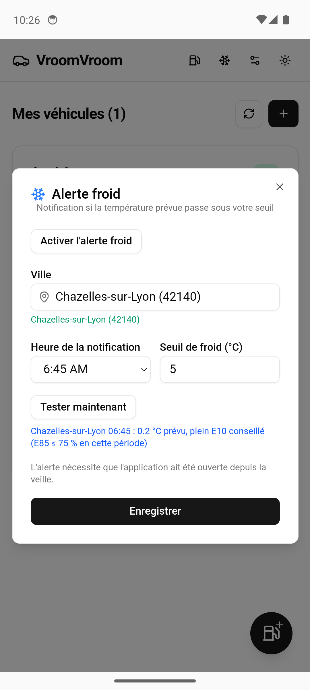
*Prévision open-meteo par commune : si la température du matin passe sous le seuil
(5 °C par défaut, heure paramétrable), notification + conseil. Le message est :
« {ville} {heure} : {temp} °C prévu : **ajoutez de l'E10 pour faciliter les
démarrages à froid** » (+ « grade E85 60 – 75 % en cette période » en hiver,
1er novembre – 15 mars). L'alerte nécessite l'app ouverte depuis la veille
(limitation Android des notifications planifiées sans accès en arrière-plan).*

### 3.6 Stations E85 (bouton pompe du header)

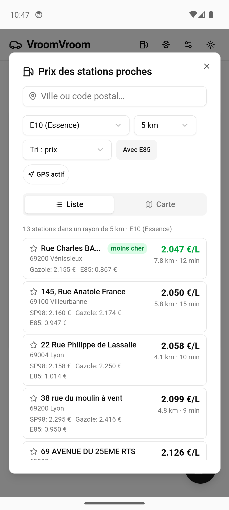
*Prix officiels des stations autour de ta position (GPS) ou d'une ville, rayon
2–50 km, tri prix/distance, temps de trajet routier (Valhalla/OSRM).
Le filtre « Avec E85 » (capture : 36 → 13 stations autour de Lyon) ne garde que
les stations avec du E85 et affiche le prix E85 de chacune.*

## 4. Permissions de l'application (extraites de l'APK compilée)

```
android.permission.INTERNET                        ← prix des stations, météo, routage,
                                                       mode serveur
android.permission.ACCESS_COARSE_LOCATION          ← recherche de stations GPS,
android.permission.ACCESS_FINE_LOCATION              position des pleins (install-time,
                                                       pas de prompt)
android.permission.POST_NOTIFICATIONS              ← alerte froid / rappels
                                                       (prompt Android 13+)
android.permission.RECEIVE_BOOT_COMPLETED          ← plugin notifications : re-planifier
                                                       après redémarrage
android.permission.WAKE_LOCK                       ← plugin notifications : déclencher à
                                                       l'heure exacte
android.permission.SCHEDULE_EXACT_ALARM            ← notifications à heure fixe
fr.ouiouibaguette.vroomvroom.DYNAMIC_RECEIVER_NOT_EXPORTED_PERMISSION  ← interne plugin
```

**Déclarer sur le Play Store** (rubrique « Permissions ») :
- **Position** (approx. et précise) — « Recherche des stations à proximité et
  enregistrement de la position de tes pleins. »
- **Affichage de notifications** — « Alerte froid (E10 à ajouter avant les vagues de
  froid) et rappels de maintenance. »
- **Réseau / Internet** — « Prix des carburants (data.economie.gouv.fr), prévisions
  météo (open-meteo.com), calcul des itinéraires (Valhalla/OSRM), mode serveur. »

**Non utilisées** (à cocher « non » si le formulaire le demande) : SMS, contacts,
appels, caméra, micro, photos/stockage, comptes, identifiants. Les données de
l'app restent sur le téléphone (mode local) ou partent vers ton propre serveur
(mode serveur) — aucune collecte de données par l'éditeur.

## 5. Ce qui est vérifié / limitations

Vérifié sur émulateur (captures ci-dessus) : onboarding, CRUD véhicule + 4 pleins,
stats live (bug d'invalidation corrigé), calculateur (seuils km + autonomie), flow
pompe complet, seed E10, alerte froid (flux open-meteo), stations + filtre E85 +
temps de trajet, panneau don, déverrouillage serveur, persistance IndexedDB.
352 tests unitaires/front + 226 tests backend, et un diff différentiel
backend-réel ↔ port-local : 0 écart de valeur sur 19 endpoints.

Limitations connues :
- Écran « À la pompe » **en ligne uniquement** (la file hors-ligne du classic
  « Ajouter un plein » gère le hors-ligne).
- L'alerte froid planifiée exige l'app ouverte depuis la veille (contrainte
  Android ; pas de foreground service par design).
- Le datalist de villes du WebView d'émulateur est capricieux (sélection au
  clavier) ; sur téléphone réel la sélection se fait normalement. Le code postal
  (ex. 69002) est plus fiable que le nom.
- Pas d'import CSV pour l'instant : pour retrouver ton historique (147 pleins /
  21 maintenances exportés le 02/11/2026) il faut soit le mode serveur connecté
  à ton API (données déjà là), soit une fonction d'import à construire.
